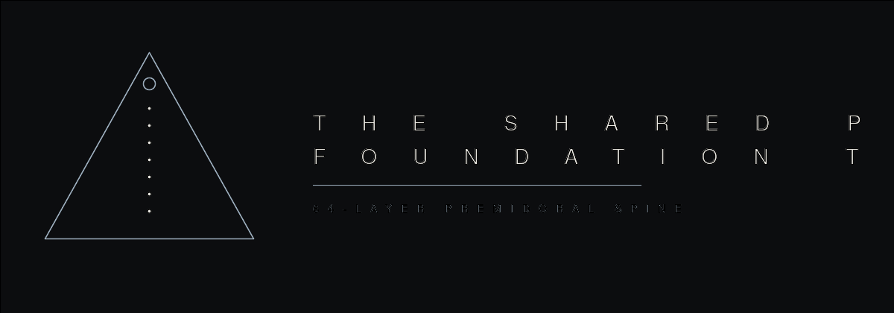

# The Shared Primordial Foundation



Constitutional root of the Bel Esprit d’Accord Trust Holdings ecosystem.

We do not build repositories. We establish foundations.

The Primordial Foundation is the origin from which every repository, organization, trust deed, governance artifact, specification, theorem, witness, and engineering standard inherits its authority.

Applications change. Frameworks change. Languages change. Foundations endure.

## Premidoral spine

The 64-layer Prime Number Premidoral functor spine is the Foundation’s multiplicity construction. Prior external attributions were removed. The spine is held by the Bel esprit D’accord Trust, SnapKitty Research Lab. Researchers: Ahmad Ali Parr, Jessica Westerhoff.

A surface reading of multiplicity is a list of prime exponents. The spine makes that list an object with depth. Each integer factors into primes. Each prime carries an exponent. The exponents form a vector. That vector is not a flat record. It is indexed through 64 layers.

Lemmas 1–32 set the base.

- A prime object cannot be written as a non-trivial tensor product.
- The multiplicity functor \(\mathcal{M}\) sends an integer to its exponent vector.
- Divisibility is preserved: if \(N\) divides \(M\), every exponent of \(N\) is at most the matching exponent of \(M\).
- Addition of exponents is adjoint to multiplication of the integers.
- Coprime integers have orthogonal multiplicity vectors.
- The energy of a factorization is \(E_N = \sum_i e_i \ln p_i\).

Lemmas 33–64 are the spine itself.

- Layer 0 is the rational boundary. Layer 63 is the holographic boundary. Layer 64 is not occupied.
- Even layers accept entropy injection. Odd layers are reserved for structure.
- A Fock cutoff bounds the occupation of each layer.
- The integrity invariant \(\mathcal{I}_{64}\) is a signed sum over the spine. A valid state keeps it inside a fixed bound.
- The Spine 64 Hex Cipher sits on this object. The integer field of a token is the prime in hexadecimal. Multiplicity is stored beside the token, not inside it.

Document: [64_layer_premidoral_spine.md](https://github.com/BEL-ESPRIT-D-ACCORD-TRUST-HOLDINGS/surface-code-boundary-lab/blob/main/docs/multiplicity/64_layer_premidoral_spine.md)

Announcement: [spine-64](https://github.com/AHMADALIPARR/the-shared-primordial-foundation/releases/tag/spine-64)

## Place in the enterprise

```
Bel Esprit d’Accord Trust Holdings
        │
        ▼
Primordial Foundation
        │
        ├── Trust deeds
        ├── Axioms
        └── Constitutions
                │
                ├── Repositories
                ├── Organizations
                └── Enterprise systems
                        │
                        ▼
                 Living infrastructure
```

## Axioms

1. **Origin.** Nothing enters the ecosystem without constitutional origin.
2. **Inheritance.** Every artifact inherits a trust relationship.
3. **Evidence.** Evidence precedes authority.
4. **Deeds.** Trust is established through explicit deeds, not implication.
5. **Governance.** Governance is architecture. Architecture is governance.

## Constitutional layers

| Layer | Name |
|------:|------|
| 0 | Primordial Foundation |
| 1 | Constitutional axioms |
| 2 | Trust deeds |
| 3 | Organizational constitutions |
| 4 | Repository charters |
| 5 | Engineering standards |
| 6 | Runtime systems |

## Trust deed model

Every repository is a governed digital estate. A trust deed may define constitutional intent, stewardship, authority, provenance, inheritance, constraints, operating principles, and organizational relationships.

Trust deeds describe how repositories relate inside the enterprise. They are not isolated software projects.

## Principles

- Origin before implementation
- Stewardship before ownership
- Evidence before assumption
- Trust before deployment
- Governance before automation
- Permanence before convenience
- Constitution before architecture

## What lives here

- Constitutional axioms
- Enterprise trust deeds
- Repository charters
- Governance specifications
- Stewardship frameworks
- Foundational standards
- Cross-repository relationships
- Enterprise identity
- Institutional memory

## Stewardship

The Foundation preserves continuity across the enterprise. Repositories may evolve. Organizations may expand. Technology will change. The constitutional foundation remains.

## Presence

- Foundation: https://github.com/AHMADALIPARR/the-shared-primordial-foundation
- Holdings: https://github.com/BEL-ESPRIT-D-ACCORD-TRUST-HOLDINGS
- Lab: https://github.com/BEL-ESPRIT-D-ACCORD-TRUST-HOLDINGS/surface-code-boundary-lab
- Atlas: https://ahmadaliparr.github.io/surface-code-boundary-lab/

---

Bel Esprit d’Accord Trust Holdings  
Foundations are inherited. Systems are constructed.
